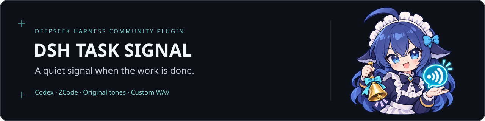
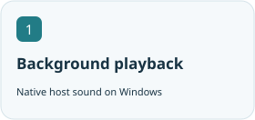
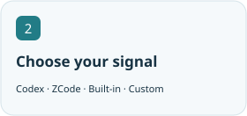
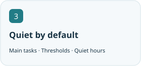

<p align="center"></p>

<h1 align="center">DSH Task Signal · 任务提示音</h1>

<p align="center">Hear when the work finishes, with a sound and reminder policy you control.</p>

<p align="center"><a href="https://github.com/tangyixiao/dsh-task-signal"></a></p>

<p align="center"><a href="README.md">简体中文</a> · <a href="README.en.md">English</a></p>

[](https://github.com/tangyixiao/dsh-task-signal/stargazers) [](https://github.com/tangyixiao/dsh-task-signal/actions/workflows/check.yml) [](LICENSE) [](https://www.npmjs.com/package/dsh-task-signal)

<p align="center">
  <picture><source media="(prefers-color-scheme: dark)" srcset="docs/assets/feature-1-en-dark.svg"></picture>
  <picture><source media="(prefers-color-scheme: dark)" srcset="docs/assets/feature-2-en-dark.svg"></picture>
  <picture><source media="(prefers-color-scheme: dark)" srcset="docs/assets/feature-3-en-dark.svg"></picture>
</p>

## Get started

Desktop: open Plugins → Add plugin and install `dsh-task-signal@0.1.2`. For a CLI-managed web profile:

```sh
dsh plugin --profile web add dsh-task-signal@0.1.2
```

Open Plugins → dsh-task-signal and preview the completion sound. **Codex style** and main-task completion are the defaults; ZCode style, six original tones and custom WAV are selectable. Windows defaults to host playback, with settings persisted across desktop port changes.

## What it does

- Independent completion, question, approval and error switches, sounds and previews; quiet subagents by default.
- Duration threshold, foreground suppression, quiet hours, temporary mute, optional notifications and speech with an editable transcript.
- Durable completion events, per-turn deduplication and single browser claims; cancellation, refresh and history stay quiet.
- Optional personal imports from installed Codex/ZCode applications. Distributed styles are independently synthesized; no application recordings are shipped.

## In DSH


The feature cards are explanatory illustrations; this screenshot shows the running settings page. Audibility also depends on the system output device, volume and browser permissions.

## Status and compatibility

| Item | Current source of truth |
| --- | --- |
| Source version | `0.1.2` · [package.json](package.json) |
| Distribution | [npm](https://www.npmjs.com/package/dsh-task-signal) · [Releases](https://github.com/tangyixiao/dsh-task-signal/releases) |
| DSH | `0.2.2-rc.3` |
| Node.js | `^22.19.0 \|\| >=24.0.0` |
| Device evidence | Windows native playback, DSH installation/loading, settings and previews tested; native macOS/Linux audio devices remain unverified |
| Development | [Open issues](https://github.com/tangyixiao/dsh-task-signal/issues?q=is%3Aissue+is%3Aopen) · [CI](https://github.com/tangyixiao/dsh-task-signal/actions) |

[Usage, sound imports, troubleshooting, updating and removal](docs/guide.en.md)

## Development and participation

No dependency installation is required:

```sh
npm run check
node tools/check-repository.mjs
```

[Contributing](CONTRIBUTING.md) · [Support](SUPPORT.md) · [Questions](https://github.com/tangyixiao/dsh-task-signal/discussions) · [Report a bug](https://github.com/tangyixiao/dsh-task-signal/issues/new/choose) · [Security](SECURITY.md) · [Maintenance](docs/maintenance.md)

## Star History

[Real Star History](https://www.star-history.com/?repos=tangyixiao/dsh-task-signal&type=date) · [GitHub Stars](https://github.com/tangyixiao/dsh-task-signal/stargazers)

This new project has little history. The external chart uses actual star records and may be unavailable; no stars or development percentages are fabricated.

## Origin and licenses

[MIT software license](LICENSE) · [Sources and references](NOTICE.md) · [Artwork attribution](assets/NOTICE.md)

The character artwork is separately CC BY-NC-SA 4.0, preserving attribution to 上善, ZipZipPipe and Small-tailqwq. Codex, ZCode and DSH are compatibility references, not endorsements.

## Project website

Download or clone this repository, then open the [English homepage](project-website/site/en/index.html) or [中文首页](project-website/site/index.html) in your browser. Both versions work offline.
