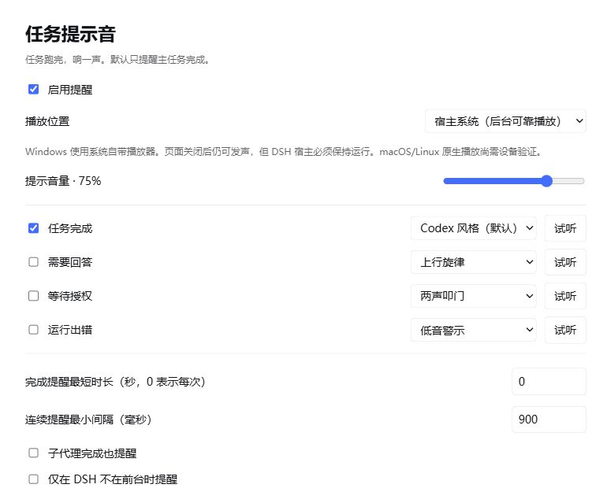

# DSH Task Signal

A completion chime for DeepSeek Harness, with Windows host-side playback that works while its window is in the background. Main-task completion is the only enabled event by default, using the Codex style.

[Source](https://github.com/tangyixiao/dsh-task-signal) · [npm](https://www.npmjs.com/package/dsh-task-signal) · [中文](README.md)

Four independent event controls: completion, question, approval, error. Codex and ZCode styles plus six original synthesized sounds, volume, previews, optional custom PCM WAV, subagent opt-in, minimum duration (default zero), foreground suppression, quiet hours, temporary mute, optional system notification and completion speech with editable transcript. Host JSON settings persist across desktop port changes. Durable events distinguish completion from cancellation; no log replay. Per-turn deduplication, burst cooldown and host claims avoid duplicate page playback. Whale coexistence checks actual activation; other notification plugins must be disabled separately for matching events.

Open Plugins → dsh-task-signal and use the Task Signal panel to preview a sound. Windows defaults to native host playback; browser mode requires an open page and an initial gesture. Native audio requires the host to keep running. Speech and notifications always require an open page; notifications need permission. Default speech transcript: `任务完成了` (“Task completed”), editable in settings.

Background-only mode uses page focus heartbeats that expire after 15 seconds. Quiet hours use host local time. Upload one 16-bit PCM WAV, mono/stereo, 8–48 kHz, no more than 2 MiB or 8 seconds. Host volume applies to custom WAV too; deleting it resets affected events to Codex. The source-only helper `tools/import-local-sounds.mjs --codex WAV --zcode-asar ASAR --ffmpeg EXE` can optionally import sounds from the user's installed applications for local personal playback. It never downloads a converter. Imported originals remain local and are not redistributed; absent imports use independent synthesized approximations.

Install `dsh-task-signal@0.1.0` through the desktop plugin manager, or run `dsh plugin --profile web add dsh-task-signal@0.1.0` for a CLI-managed web profile.

No dependency installation or build tool download is required: `npm run check`, then `npm pack`. Install the resulting local tarball through the desktop plugin manager. A CLI-managed web profile supports `dsh plugin --profile web add file:D:\path\dsh-task-signal-0.1.0.tgz`.

Target: DSH **0.2.2-rc.3**. Windows is the native playback validation platform. macOS `afplay` and Linux `aplay` have not been device-tested; missing players produce a visible failure and browser mode remains available. Packages are available from npm and GitHub Releases; third-party market admission is tracked separately.

Data lives under `$DSH_HOME/dsh-task-signal/`, normally `~/.dsh/dsh-task-signal/`: settings, optional custom WAV and Codex/ZCode local presets, and a playback WAV removed after use. Owner-authenticated loopback routes; no chat transcript storage, external requests or telemetry; a bounded 64-event in-memory queue. A successful native player exit is not proof of physical audibility. Synthetic fixtures do not prove live model inference. See [NOTICE.md](NOTICE.md) for sources and [README.md](README.md) for Chinese instructions.
