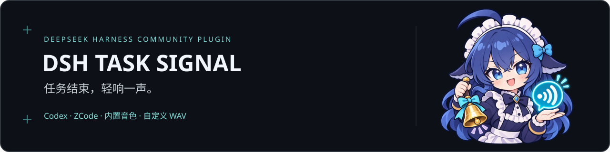
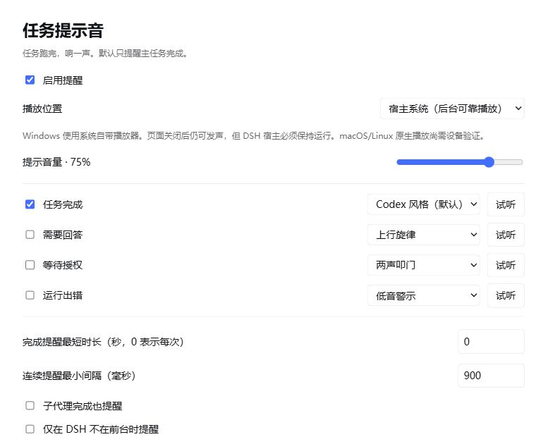

<p align="center"></p>

<h1 align="center">DSH Task Signal · 任务提示音</h1>

<p align="center">任务结束，轻响一声。用你熟悉的声音，按自己的节奏回来。</p>

<p align="center"><a href="https://github.com/tangyixiao/dsh-task-signal"></a></p>

<p align="center"><a href="README.md">简体中文</a> · <a href="README.en.md">English</a></p>

[](https://github.com/tangyixiao/dsh-task-signal/stargazers) [](https://github.com/tangyixiao/dsh-task-signal/actions/workflows/check.yml) [](LICENSE) [](https://www.npmjs.com/package/dsh-task-signal)

<p align="center">
  <picture><source media="(prefers-color-scheme: dark)" srcset="docs/assets/feature-1-zh-CN-dark.svg"></picture>
  <picture><source media="(prefers-color-scheme: dark)" srcset="docs/assets/feature-2-zh-CN-dark.svg"></picture>
  <picture><source media="(prefers-color-scheme: dark)" srcset="docs/assets/feature-3-zh-CN-dark.svg"></picture>
</p>

## 开始使用

Desktop：打开「插件 → 添加插件」，输入 `dsh-task-signal@0.1.3`，安装并启用。CLI 管理的网页 profile 可用：

```sh
dsh plugin --profile web add dsh-task-signal@0.1.3
```

进入「插件 → dsh-task-signal」，点“任务完成 · 试听”。默认采用 **Codex 风格**，只开主任务完成提醒；ZCode、六种原创音色和自定义 WAV 均可选择。Windows 默认由宿主播放，页面换端口不会丢失设置。

## 能做什么

- 完成、提问、授权、出错分别设置开关、声音与试听。子代理默认静音。
- 可设置时长阈值、仅后台提醒、跨午夜免打扰、临时静音，以及可选通知和语音播报。
- 正常回合完成才响；主动停止、刷新页面、历史记录不会重放。宿主去重与页面领取机制抑制重复提醒。
- 本机可导入已安装 Codex/ZCode 的音效；发行包使用独立合成的风格音色，不分发应用原录音。

## 实际界面



上方功能卡为说明图；这张截图来自实际 DSH 设置页。声音大小还取决于系统输出设备、音量和页面权限。

## 当前状态与兼容性

| 项目 | 当前依据 |
| --- | --- |
| 源码版本 | `0.1.3` · 以 [package.json](package.json) 为准 |
| 分发方式 | [npm](https://www.npmjs.com/package/dsh-task-signal) · [Releases](https://github.com/tangyixiao/dsh-task-signal/releases) |
| DSH | `0.2.2-rc.3 \|\| 0.2.2-rc.5` |
| Node.js | `^22.19.0 \|\| >=24.0.0` |
| 实机依据 | Windows 系统播放、DSH 安装/加载、设置保存和试听已验证；macOS/Linux 原生音频仍待设备验证 |
| 开发状态 | [Open issues](https://github.com/tangyixiao/dsh-task-signal/issues?q=is%3Aissue+is%3Aopen) · [CI](https://github.com/tangyixiao/dsh-task-signal/actions) |

[详细使用、音色导入、故障排查、更新与卸载](docs/guide.zh-CN.md)

## 开发与参与

无需安装依赖：

```sh
npm run check
node tools/check-repository.mjs
```

[Contributing](CONTRIBUTING.md) · [Support](SUPPORT.md) · [Questions](https://github.com/tangyixiao/dsh-task-signal/discussions) · [Report a bug](https://github.com/tangyixiao/dsh-task-signal/issues/new/choose) · [Security](SECURITY.md) · [Maintenance](docs/maintenance.md)

## Star History

[查看真实 Star History](https://www.star-history.com/?repos=tangyixiao/dsh-task-signal&type=date) · [GitHub Stars](https://github.com/tangyixiao/dsh-task-signal/stargazers)

新项目的数据较少，图表由外部服务按真实星标记录生成，可能暂不可用；不编造星标或开发百分比。

## 来源与许可

[软件许可 MIT](LICENSE) · [方案参考与来源](NOTICE.md) · [角色美术与署名](assets/NOTICE.md)

角色美术单独采用 CC BY-NC-SA 4.0，保留上善、ZipZipPipe、Small-tailqwq 的署名链。Codex、ZCode、DSH 仅用于兼容性说明，不代表官方合作。

## 项目网站

下载或克隆仓库后，用浏览器打开[中文首页](project-website/site/index.html)或 [English homepage](project-website/site/en/index.html)。两个版本都可以离线阅读。
